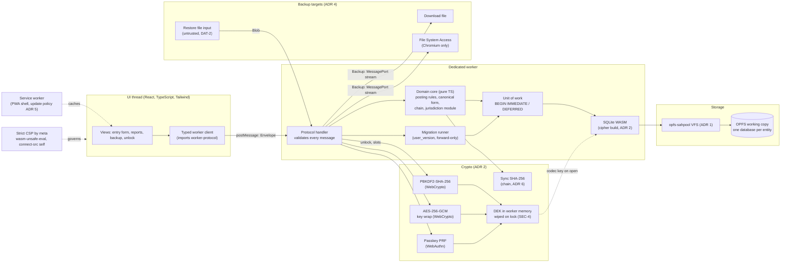
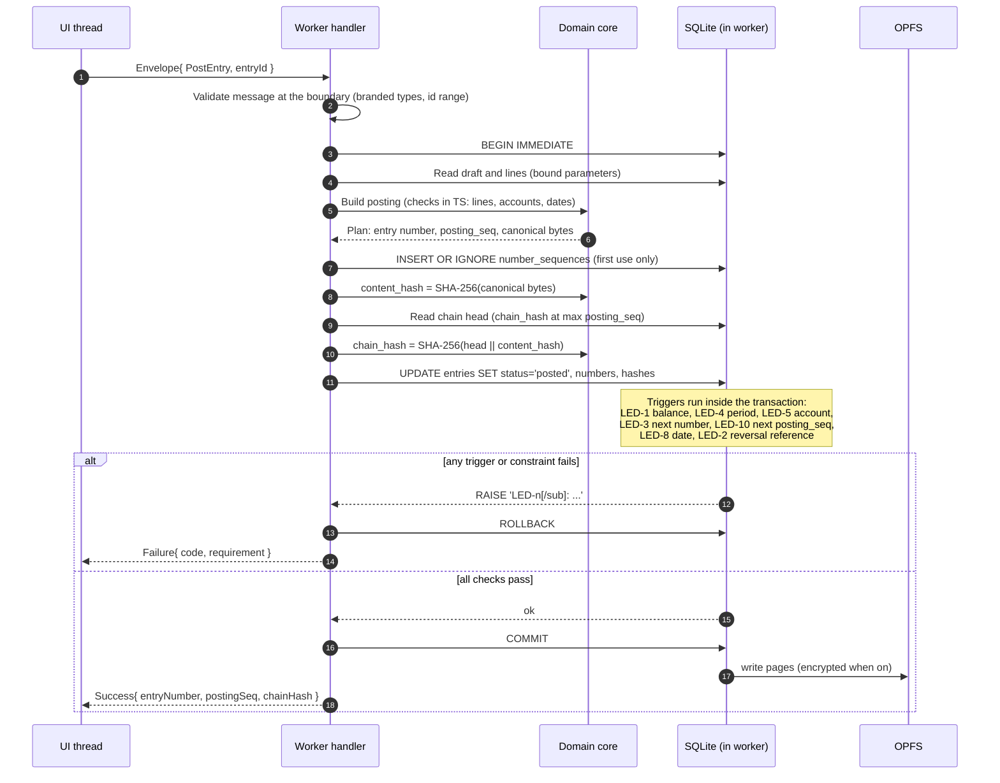

# Architecture

- **Status:** Stage 1 design, awaiting owner approval. Decisions are in [`adr/`](adr/); this file shows how the parts connect.
- **Requirements:** NFR-1, NFR-2, NFR-3, NFR-5, SEC-1 to SEC-5, DAT-1 to DAT-6, LED-1 to LED-10.
- **Scope:** [PRD](prd.md). Rules for building it: [PROMPT.md](../PROMPT.md).
- **Crypto:** the live database uses OS full-disk encryption (SEC-1). The only crypto in v1 is the passphrase-encrypted backup export (SEC-2), with WebCrypto. The key-slot components are not built.

## 1. Components

The UI thread never touches the database. Every database operation is a typed message to the worker (PROMPT.md, stack). Domain code depends on interfaces it owns; the worker, SQLite, OPFS and WebCrypto are adapters behind them (PROMPT.md, dependency inversion).

Config (one typed module) names the VFS, the database file, the Web Lock name, storage keys, the chunk size and the allow-listed lookup endpoints. Build-time values (base path, domain) come from validated environment variables. The CSP, PWA manifest and service-worker scope are generated from config (PROMPT.md, SSOT).

## 2. Data flow: posting an entry end to end

Posting is one unit of work. Either the entry, its number, its hashes and its chain position commit together, or none of them do (LED-1 to LED-3, LED-10).

Reads follow the same path without the write step: `BEGIN DEFERRED`, bound parameters, rows back as a page or summary, `COMMIT` (no-op), never touching the draft rows (LED-11).

## 3. Trust boundaries

| #   | Boundary                       | What crosses it                                                                | Who is trusted on each side                                                                                          | Validation at the crossing                                                                                            |
| --- | ------------------------------ | ------------------------------------------------------------------------------ | -------------------------------------------------------------------------------------------------------------------- | --------------------------------------------------------------------------------------------------------------------- |
| TB1 | UI thread ↔ worker             | Typed `Envelope` requests; `Blob` for restore; `MessagePort` for backup stream | UI code is treated as untrusted input: an XSS on this origin could send any message.                                 | Worker validates every field (branded types, ranges, enums) before any SQL.                                           |
| TB2 | Worker ↔ OPFS                  | Database pages, journal, attachment chunks                                     | The browser's storage layer. Other origins cannot read it; the browser profile and anything running as the user can. | Page-level codec when encryption is on (SEC-1). `quick_check` on open.                                                |
| TB3 | Worker ↔ crypto                | Passwords, recovery code, passkey PRF output, DEK                              | Worker memory only.                                                                                                  | Keys never leave the worker, never logged, wiped on lock (SEC-4).                                                     |
| TB4 | Browser ↔ backup file (import) | A complete database file chosen by the user                                    | Untrusted (DAT-2).                                                                                                   | Header check, defensive mode, `trusted_schema = OFF`, `integrity_check`, schema version check, attachment hash check. |
| TB5 | Browser ↔ backup file (export) | A database file or CSV leaving the app                                         | The user, once the file is theirs.                                                                                   | Full chain verification before export (ADR 6); CSV formula neutralization (DAT-7).                                    |
| TB6 | App ↔ network                  | Requests from the app to its origin and to optional lookups                    | Only the app's origin and allow-listed lookups (SEC-5).                                                              | CSP `connect-src`; no ledger data in any request.                                                                     |
| TB7 | Passkey authenticator ↔ app    | PRF output derived by the platform                                             | Platform authenticator (outside the app's control).                                                                  | Passkey slots are per-device; each is confirmed by an immediate unlock (ADR 2).                                       |
| TB8 | Build and deploy ↔ browser     | The bundle and its service worker                                              | The build pipeline and the host.                                                                                     | Pinned action SHAs, lockfile, `npm ci`, SBOM, provenance, reproducible-build check (Phase 6).                         |
| TB9 | Service worker ↔ app code      | Cached assets and update decisions                                             | The service worker controls which code runs.                                                                         | Update only when no database connection is open (ADR 5).                                                              |

The threat model for each boundary is in [security.md](security.md).

## 4. Browser support matrix (NFR-3)

The matrix below lists what each capability needs and what I expect from the engines. **These cells are expectations from release history, not verified in this session.** The Phase 0 spike and the Playwright suite in each engine verify them before the matrix is accepted. Rows the spike cannot confirm change ADR 1 or ADR 4.

Only Chromium (Chrome, Edge) is supported in v1 (PRD NFR-3, owner decision 2026-10-13). Safari is out of scope until it is reconsidered before v1.0.

| Capability                                | Used for                                                 | Chromium (Chrome, Edge)      |
| ----------------------------------------- | -------------------------------------------------------- | ---------------------------- |
| OPFS                                      | Working copy (ADR 1)                                     | Yes                          |
| Sync access handle in a worker            | `opfs-sahpool` I/O                                       | Yes                          |
| `opfs-sahpool` VFS                        | Chosen VFS (ADR 1)                                       | Expected                     |
| `opfs` / `opfs-wl` VFS                    | Rejected (needs COOP and COEP)                           | Not used                     |
| SharedArrayBuffer                         | Required only by `opfs`/`opfs-wl`, not by the chosen VFS | Needs cross-origin isolation |
| Web Locks                                 | One-connection rule (ADR 1)                              | Yes                          |
| Service worker                            | PWA, offline (NFR-2)                                     | Yes                          |
| `navigator.storage.persist()`             | DAT-4                                                    | Yes                          |
| File System Access (`showSaveFilePicker`) | Preferred backup target (ADR 4)                          | Yes                          |
| WebAuthn PRF                              | Passkey unlock (SEC-2)                                   | Expected (116+); verify      |
| Trusted Types                             | CSP enforcement (PROMPT.md)                              | Yes                          |
| Playwright engine for CI                  | NFR-3 tests                                              | Chromium                     |

Consequences of the matrix:

- **Backup:** File System Access is the preferred target; download is the fallback (ADR 4).
- **Passkey:** optional. The password and recovery code are the complete path (PRD §6).
- **Persistence:** where `persist()` is denied, the install recommendation applies (DAT-4).
- **Trusted Types:** support in Chromium is confirmed in the spike. If it is not enforced, the "no `dangerouslySetInnerHTML`, no unsafe sinks" rule carries the load. The PROMPT.md claim is flagged in [prd-updates-stage1.md](prd-updates-stage1.md) as an assumption to verify.
- **No IndexedDB tier** is needed on the current assumptions (ADR 4).

## 5. Module and file map (to be created in Phase 0)

| Area            | Contents                                                                        | Boundary                                    |
| --------------- | ------------------------------------------------------------------------------- | ------------------------------------------- |
| `src/domain/`   | Posting rules, canonical form, chain, jurisdiction module (Finland only, YAGNI) | Imports no UI, worker or browser API (lint) |
| `src/db/`       | Unit of work, migration runner, SQL adapters                                    | Owns SQLite access                          |
| `src/worker/`   | Message handler, wiring                                                         | Only place that touches `postMessage`       |
| `src/protocol/` | `worker-protocol.ts`, imported by worker and UI                                 | Single source of message shapes             |
| `src/crypto/`   | Key slots, KDF, wrap, PRF adapter (Phase 5)                                     | Only WebCrypto and the PRF adapter          |
| `src/ui/`       | React views                                                                     | Talks only to the typed client              |
| `docs/schema/`  | `migration-001.sql` and later migrations, `queries.sql`                         | The schema's only definition                |
| `config/`       | Typed config module, env validation                                             | All names, paths, keys, hosts               |
